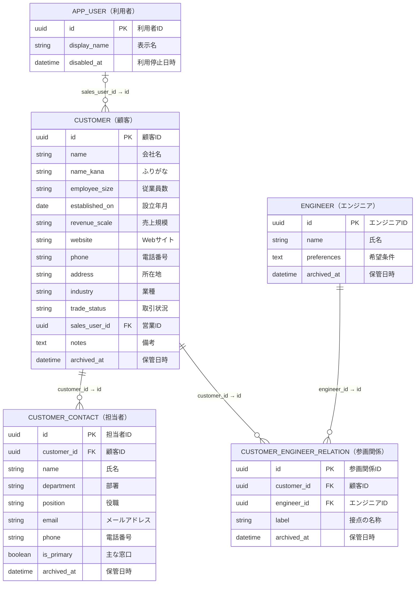
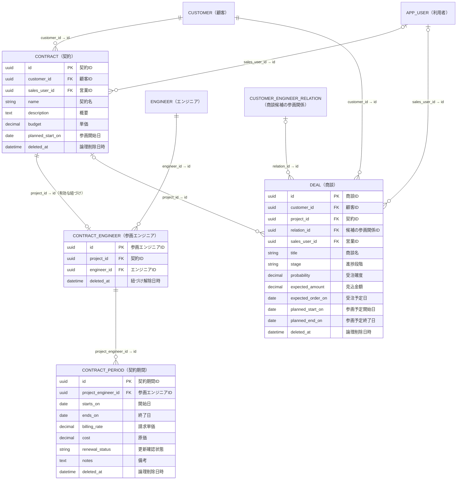
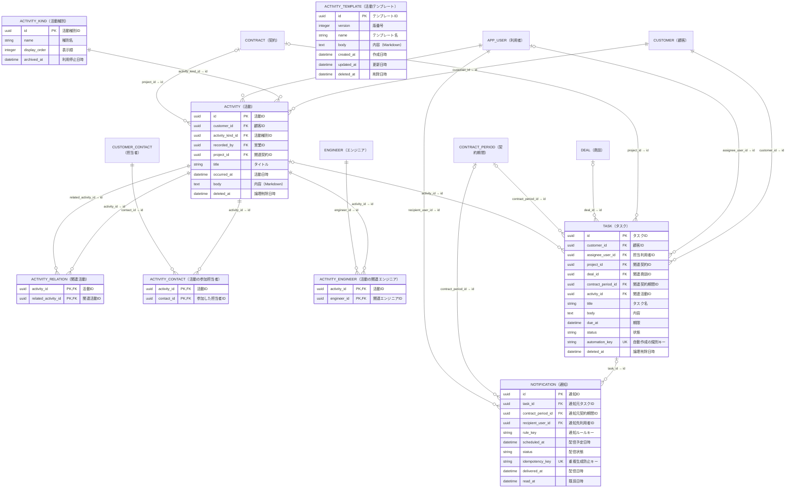

# SES向けCRM ER図

顧客・エンジニア・担当者・契約・商談・参画エンジニア・契約期間・活動・タスクは、それぞれ通常のテーブルで管理する。名前・日付・金額・状態・担当者などの標準項目は列に持ち、関連は外部キーで表す。今後の機能追加は、業務ごとのテーブルに必要な列や関連テーブルを追加して対応する。

本図は専用テーブルで構成したアプリ・新規導入用マイグレーションの論理モデル。既存の[ADR](adr/)は旧設計の記録として残しており、本図と一致しない箇所がある。利用目的は[ユーザーストーリー](user-stories.md)を参照する。

図の型は概念的な型。各業務テーブルに共通する`created_at`（作成日時）、`updated_at`（更新日時）、`version`（同時編集検出用の版番号）は図では省略する。金額は正確な十進数で扱う。

線のラベルは`外部キー → 参照先の主キー`をフィールド名だけで示す。

## 顧客・エンジニア・担当者

顧客の住所や営業、エンジニアの希望条件も、それぞれのテーブルに直接保存する。「基本情報」のために別の記録を作る必要はない。

参画関係は「青空システムへの山田さんの提案から参画まで」のような接点を表す。同じ顧客とエンジニアでも別契約への提案には別の関係を作れるため、両IDの組み合わせは一意にしない。契約への紐づけは参画エンジニアで管理し、参画関係は商談の候補を表す。担当者と、自社のログイン利用者である`APP_USER`は区別する。

## 契約・エンジニア・契約期間

契約を管理単位とし、1契約につき1人のエンジニアを紐づける。1件の契約（契約）に紐づけるエンジニアは1人とする。複数人が同じ内容で参画する場合は、契約を複製して1人ずつ登録する。参画期間・請求単価・原価はエンジニアごとに管理する。上部の「担当者」「商談」は設けず、担当者は取引先詳細、商談は活動の種別から確認する。登録済み全エンジニアの管理は上部の「エンジニア」、顧客の契約に紐づくエンジニアと期間の確認は取引先詳細の「参画エンジニア」で行う。

- 1契約につき有効な参画エンジニアは最大1人とし、未定（0人）でもよい。同じエンジニアが複数の契約に属することは可能。紐づけ変更前の行は解除済みの履歴として残す。
- エンジニアの紐づけは契約本体と同時に保存し、履歴に残す。紐づけを解除しても契約期間や過去の条件は削除しない。再度紐づける際は同じ参画エンジニアIDを復元する。
- 契約期間には開始日・終了日・請求単価・原価を持たせる。開始日≦終了日、金額は0以上、同一参画エンジニアの有効な期間は重複不可とする。別エンジニアの期間は重なってよい。
- 契約複製では契約の標準項目と最新の有効な契約期間を下書きにコピーし、エンジニアや条件を変更してから一括保存する。活動・タスク・過去の期間・変更履歴はコピーしない。
- 更新時は同じ参画エンジニアに契約期間を追加し、過去の期間や単価を上書きしない。営業と更新通知の担当は契約から取得する。
- 商談の契約・候補は任意とする。候補の商談ステータスによって契約登録やエンジニアの紐づけを制限しない。関連付ける顧客は一致させる。

## 活動・タスク・通知

活動とタスクは必ず顧客に属する。活動は契約への任意の外部キーと関連活動で関連付ける。商談の活動も関連活動から選択し、活動に専用の商談IDは持たせない。タスクは契約・商談などへの任意の外部キーで関連付け、同じ内容を関連先ごとに複製しない。活動には顧客側の参加担当者と、関連するエンジニアをそれぞれ複数人登録できる。エンジニアは活動への参加有無にかかわらず紐づけでき、契約の指定や顧客との参画関係の登録は必須としない。

活動間の関連は`ACTIVITY_RELATION`で0件以上を選択でき、自己参照・重複・別顧客への関連付けは不可とする。選択した活動から関連先を参照し、逆方向の関連は自動追加しない。活動一覧は「関連活動」「関連契約」を別列で表示する。活動の内容はMarkdown文字列として保存し、商談・面談・その他のテンプレートを選択して入力できる。内容セルからダイアログを開いて編集・プレビューする。契約・商談などの関連先は種類ごとに0〜1件、活動の参加者は中間テーブルで複数件を扱う。担当者と各関連先は、活動・タスクの顧客と一致させる。契約と契約期間などを同時指定した場合は、相互の対応も検証する。中間テーブルは2列の組み合わせを主キーにして参加者の重複を防ぐ。

活動とエンジニアは`ACTIVITY_ENGINEER`を介した多対多の関係とする。1件の活動に0件以上のエンジニアを紐づけ、同じエンジニアを複数の活動から参照できる。紐づけの追加・解除は活動本体と同時に保存し、変更履歴にも残す。保管済みエンジニアの既存の紐づけは表示・維持できるが、新たな紐づけの候補には含めない。

エンジニアに関連する活動は活動エンジニア、契約に関連する活動・タスクは契約IDから取得する。複数の経路で見つかる活動はIDでまとめる。顧客に紐づかない社内活動などは本図の対象外とする。

商談・面談・その他の3つを`ACTIVITY_KIND`の標準データとして提供する。契約は管理対象であり、活動カテゴリには含めない。種別を利用者が自由に定義する設定機能は設けない。

通知元は`task_id`と`contract_period_id`のいずれか1つだけを設定する。タスク通知は`TASK.due_at`・`status`・`assignee_user_id`、契約更新処理は`CONTRACT_PERIOD.ends_on`・`renewal_status`と契約の営業を直接参照する。通知に必要な値が未入力なら対象外として理由を表示する。

契約更新タスクの`automation_key`は契約期間とルールから決め、再実行時は同じタスクを更新する。通知は通知機会ごとの`idempotency_key`で重複を防ぐ。期限・状態・担当変更時は未配信通知を見直し、配信直前にも最新状態を確認する。配信済み・既読履歴は残す。

## データの登録例

IDはUUIDを読みやすい略称で表す。省略した任意列は`null`とする。状態コードや金額・日付は説明用の例。

### 同じ内容の契約をエンジニアごとに登録する

| テーブル          | 保存する値（主要列）                                                                                                                               |
| ----------------- | -------------------------------------------------------------------------------------------------------------------------------------------------- |
| CONTRACT          | `id: project-1, customer_id: c-aozora, name: 基幹システム刷新, sales_user_id: u-sato`                                                              |
| CONTRACT          | `id: project-2, customer_id: c-aozora, name: 基幹システム刷新（高橋）, sales_user_id: u-sato`                                                      |
| ENGINEER          | `id: e-yamada, name: 山田太郎`                                                                                                                     |
| ENGINEER          | `id: e-takahashi, name: 高橋美咲`                                                                                                                  |
| CONTRACT_ENGINEER | `id: pe-1, project_id: project-1, engineer_id: e-yamada`                                                                                           |
| CONTRACT_ENGINEER | `id: pe-2, project_id: project-2, engineer_id: e-takahashi`                                                                                        |
| CONTRACT_PERIOD   | `id: period-1, project_engineer_id: pe-1, starts_on: 2026-10-01, ends_on: 2026-12-31, billing_rate: 800000, cost: 600000, renewal_status: pending` |
| CONTRACT_PERIOD   | `id: period-2, project_engineer_id: pe-2, starts_on: 2026-10-01, ends_on: 2026-12-31, billing_rate: 900000, cost: 650000, renewal_status: pending` |

2人はそれぞれの契約に属し、期間と金額を個別に保持する。更新時は同じ`pe-1`や`pe-2`に次の期間を追加する。

### 活動と更新確認

| テーブル          | 保存する値（主要列）                                                                                                                                                                                   |
| ----------------- | ------------------------------------------------------------------------------------------------------------------------------------------------------------------------------------------------------ |
| ACTIVITY          | `id: activity-1, customer_id: c-aozora, project_id: project-1, activity_kind_id: kind-interview, recorded_by: u-sato, title: 開発体制の確認, occurred_at: 2026-10-19T14:00:00+09:00`                   |
| ACTIVITY_ENGINEER | `activity_id: activity-1, engineer_id: e-yamada`                                                                                                                                                       |
| ACTIVITY_ENGINEER | `activity_id: activity-1, engineer_id: e-takahashi`                                                                                                                                                    |
| TASK              | `id: task-1, customer_id: c-aozora, project_id: project-1, contract_period_id: period-1, assignee_user_id: u-sato, title: 基幹システム刷新の更新確認, due_at: 2026-12-31T17:00:00+09:00, status: open` |

活動のエンジニアは契約への紐づけとは独立して指定できる。更新通知は参画エンジニアの契約期間ごとに生成し、契約の営業へ通知する。

## 履歴・削除・整合性

顧客・エンジニア・担当者・参画関係は保管でき、過去の関連情報を維持する。契約・商談・参画エンジニア・契約期間・活動・タスクは論理削除と復元を基本とする。削除した対象も参照先としての存在は残し、通常一覧や通知から除外する。参照先を削除しただけで、関連データを連鎖削除しない。

保存時は版番号によって同時編集を検出し、変更履歴も同じトランザクションで残す。各業務テーブルに対応する履歴テーブルを設け、対象への外部キー、版番号、操作、変更者、変更日時、変更時点の内容を保持する。履歴は対象IDと版番号を一意にし、追記のみとする。図では履歴テーブルを省略している。

契約更新で新しい期間を作ることと、既存期間の入力ミスを訂正して履歴を残すことは区別する。履歴には業務データの列・関連先IDと当時の表示名を含め、後の表示名変更でも意味を確認できるようにする。

活動テンプレートは`activity_templates`に保存し、右上の歯車アイコンから設定メニューの「活動テンプレート」を選び、追加・編集・論理削除・復元する。商談・面談・その他を初期データとして提供する。活動への挿入はMarkdown本文のコピーとし、テンプレートへの外部キーは持たない。テンプレートの変更や削除で入力済みの活動本文は変わらない。テンプレートの変更も版番号と専用の`activity_templates_revisions`で履歴を保持する。

活動種別の利用停止は新規入力を止め、既存の活動と履歴は残す。

外部キー、所有顧客の一致、期間の重複防止、同時更新はDBで保証する。複数行を扱う更新は同じトランザクションで行う。参画関係の顧客・エンジニアなど、参照先の付け替えで既存の整合性を壊す変更も防ぐ。

認証方式・組織境界・詳細な権限・通知チャネル・物理索引の変更は本図では扱わない。1件の活動に複数契約を結ぶ機能は現在の範囲に含めない。

物理テーブル名は、契約が `projects`、参画エンジニアが `project_engineers` のままとする。図の `CONTRACT`・`CONTRACT_ENGINEER` は画面上の名称に合わせた論理名で、`project_id`・`project_engineer_id` はそれぞれへの外部キーである。

活動種別の「面談」は、エンジニアが参画するために顧客と行う面談を指します。顧客との相談・提案・条件調整は「商談」、参画後のフォローやフィードバックなどは「その他」として記録します。
