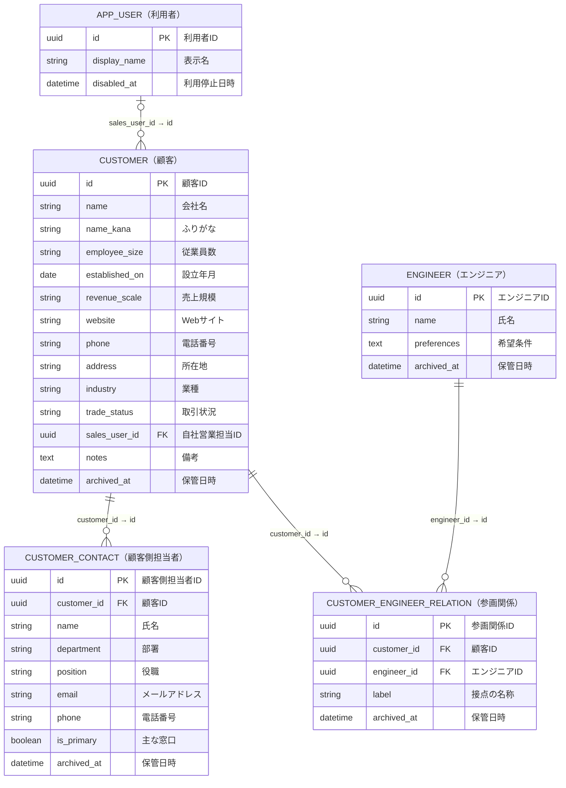
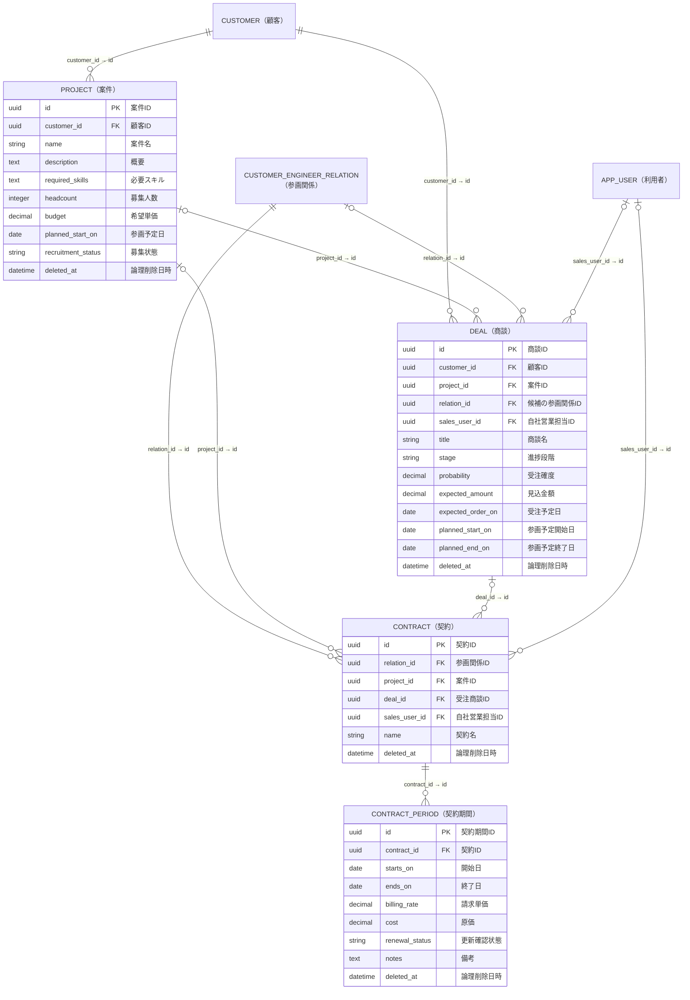
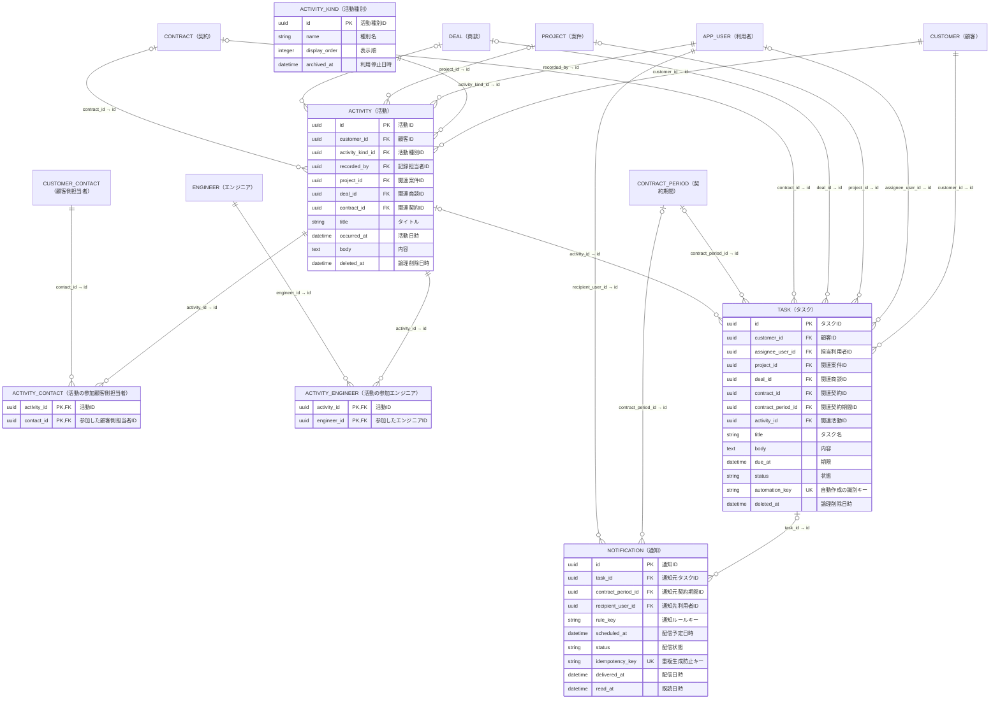

# SES向けCRM ER図

顧客・エンジニア・顧客側担当者・案件・商談・契約・契約期間・活動・タスクは、それぞれ通常のテーブルで管理する。名前・日付・金額・状態・担当者などの標準項目は列に持ち、関連は外部キーで表す。今後の機能追加は、業務ごとのテーブルに必要な列や関連テーブルを追加して対応する。

本図は専用テーブルで構成したアプリ・新規導入用マイグレーションの論理モデル。既存の[ADR](adr/)は旧設計の記録として残しており、本図と一致しない箇所がある。利用目的は[ユーザーストーリー](user-stories.md)を参照する。

図の型は概念的な型。各業務テーブルに共通する`created_at`（作成日時）、`updated_at`（更新日時）、`version`（同時編集検出用の版番号）は図では省略する。金額は正確な十進数で扱う。

線のラベルは`外部キー → 参照先の主キー`をフィールド名だけで示す。

## 顧客・エンジニア・顧客側担当者

顧客の住所や営業担当、エンジニアの希望条件も、それぞれのテーブルに直接保存する。「基本情報」のために別の記録を作る必要はない。

参画関係は「青空システムへの山田さんの提案から参画まで」のような接点を表す。同じ顧客とエンジニアでも別案件への提案には別の関係を作れるため、両IDの組み合わせは一意にしない。契約更新では同じ関係を使う。顧客側担当者と、自社のログイン利用者である`APP_USER`は区別する。

## 案件・商談・契約・契約期間

案件は募集内容、商談は提案と受注までの進捗、契約は継続する契約の単位、契約期間は期間ごとの条件を保持する。

- 案件と商談は必ず顧客に属する。商談の案件・候補は未定でもよい。候補決定時に参画関係を作り、`DEAL.relation_id`へ設定する。
- 契約は必ず参画関係に属する。顧客とエンジニアはそこから取得する。案件・受注商談は必要に応じて関連付ける。
- 商談・案件・参画関係・契約を結ぶときは顧客が一致することを検証する。受注商談に候補が設定済みなら、契約の参画関係とも一致させる。
- 契約期間には開始日・終了日・請求単価・原価を持たせる。開始日≦終了日、金額は0以上、同一契約の有効な期間は重複不可とする。未入力と0は区別する。
- 契約更新では`CONTRACT_PERIOD`を追加する。過去の期間や単価を上書きしない。契約の開始前・契約中・終了済みは期間から判断する。
- 受注確度は0〜100の範囲で扱う。標準の状態値は業務側の列として検証し、自動処理もその列を直接読む。

## 活動・タスク・通知

活動とタスクは必ず顧客に属する。案件・商談・契約などへの任意の外部キーで関連付け、同じ内容を関連先ごとに複製しない。活動の参加者は複数人を登録できる。

活動・タスクの関連先は種類ごとに0〜1件、活動の参加者は中間テーブルで複数件を扱う。顧客側担当者と各関連先は、活動・タスクの顧客と一致させる。契約と契約期間などを同時指定した場合は、相互の対応も検証する。中間テーブルは2列の組み合わせを主キーにして参加者の重複を防ぐ。

エンジニアの画面では参加活動や、そのエンジニアの参画関係に属する契約に関連した活動・タスクを取得する。複数の経路で見つかる活動はIDでまとめる。顧客に紐づかない社内活動などは本図の対象外とする。

電話・訪問・面談・フィードバックは`ACTIVITY_KIND`の標準データとして提供する。種別を利用者が自由に定義する設定機能は設けない。

通知元は`task_id`と`contract_period_id`のいずれか1つだけを設定する。タスク通知は`TASK.due_at`・`status`・`assignee_user_id`、契約更新処理は`CONTRACT_PERIOD.ends_on`・`renewal_status`と契約の営業担当を直接参照する。通知に必要な値が未入力なら対象外として理由を表示する。

契約更新タスクの`automation_key`は契約期間とルールから決め、再実行時は同じタスクを更新する。通知は通知機会ごとの`idempotency_key`で重複を防ぐ。期限・状態・担当変更時は未配信通知を見直し、配信直前にも最新状態を確認する。配信済み・既読履歴は残す。

## データの登録例

IDはUUIDを読みやすい略称で表す。省略した任意列は`null`とする。状態コードや金額・日付は説明用の例。

### 顧客登録から契約まで

| テーブル         | 保存する値（主要列）                                                                                                                 |
| ---------------- | ------------------------------------------------------------------------------------------------------------------------------------ |
| APP_USER         | `id: u-sato, display_name: 佐藤花子`                                                                                                 |
| CUSTOMER         | `id: c-aozora, name: 青空システム, address: 東京都千代田区, trade_status: active, sales_user_id: u-sato`                             |
| ENGINEER         | `id: e-yamada, name: 山田太郎`                                                                                                       |
| CUSTOMER_CONTACT | `id: contact-suzuki, customer_id: c-aozora, name: 鈴木一郎, department: 情報システム部, is_primary: true`                            |
| PROJECT          | `id: project-1, customer_id: c-aozora, name: 基幹システム刷新, required_skills: Java, headcount: 1, budget: 800000`                  |
| DEAL             | `id: deal-1, customer_id: c-aozora, project_id: project-1, title: 基幹システム刷新への提案, stage: proposing, sales_user_id: u-sato` |

ここまでで候補未定の商談を登録できる。山田さんを提案する段階で、`CUSTOMER_ENGINEER_RELATION`に`id: rel-1, customer_id: c-aozora, engineer_id: e-yamada`を作り、商談の`relation_id`に`rel-1`を設定する。

受注時は商談を`stage: won, probability: 100`へ更新し、次の行を作る。

| テーブル        | 保存する値（主要列）                                                                                                                             |
| --------------- | ------------------------------------------------------------------------------------------------------------------------------------------------ |
| CONTRACT        | `id: contract-1, relation_id: rel-1, project_id: project-1, deal_id: deal-1, sales_user_id: u-sato, name: 山田さん 基幹システム刷新契約`         |
| CONTRACT_PERIOD | `id: period-1, contract_id: contract-1, starts_on: 2026-10-01, ends_on: 2026-12-31, billing_rate: 800000, cost: 600000, renewal_status: pending` |

「山田さんの請求単価」は`CONTRACT_PERIOD.billing_rate`、「契約の営業担当」は`CONTRACT.sales_user_id`から読める。

### 面談と更新確認

| テーブル          | 保存する値（主要列）                                                                                                                                                                                                  |
| ----------------- | --------------------------------------------------------------------------------------------------------------------------------------------------------------------------------------------------------------------- |
| ACTIVITY_KIND     | `id: kind-interview, name: 面談`                                                                                                                                                                                      |
| ACTIVITY          | `id: activity-1, customer_id: c-aozora, activity_kind_id: kind-interview, recorded_by: u-sato, deal_id: deal-1, title: 山田さんと鈴木さんの面談, occurred_at: 2026-09-15T14:00:00+09:00, body: 参画条件を確認した`    |
| ACTIVITY_CONTACT  | `activity_id: activity-1, contact_id: contact-suzuki`                                                                                                                                                                 |
| ACTIVITY_ENGINEER | `activity_id: activity-1, engineer_id: e-yamada`                                                                                                                                                                      |
| TASK              | `id: task-1, customer_id: c-aozora, contract_period_id: period-1, assignee_user_id: u-sato, title: 山田さんの契約更新を確認, due_at: 2026-11-30T17:00:00+09:00, status: open`                                         |
| NOTIFICATION      | `id: notification-1, task_id: task-1, contract_period_id: null, recipient_user_id: u-sato, rule_key: task_due, scheduled_at: 2026-11-30T17:00:00+09:00, status: pending, idempotency_key: task-1-due-20261130-u-sato` |

通知キーの文字列は例示であり、実装時には通知機会を一意に表せる形式にする。自動作成タスクにも契約期間とルールから決まる`automation_key`を設定する。

契約更新が決まったら、同じ`contract-1`に次の期間を追加する。

| id               | contract_id | starts_on  | ends_on    | billing_rate | cost   |
| ---------------- | ----------- | ---------- | ---------- | ------------ | ------ |
| period-1（既存） | contract-1  | 2026-10-01 | 2026-12-31 | 800000       | 600000 |
| period-2（追加） | contract-1  | 2027-01-01 | 2027-03-31 | 820000       | 610000 |

契約と参画関係は同じままで、以前の条件と更新後の条件を比較できる。

## 履歴・削除・整合性

顧客・エンジニア・顧客側担当者・参画関係は保管でき、過去の関連情報を維持する。案件・商談・契約・契約期間・活動・タスクは論理削除と復元を基本とする。削除した対象も参照先としての存在は残し、通常一覧や通知から除外する。参照先を削除しただけで、関連データを連鎖削除しない。

保存時は版番号によって同時編集を検出し、変更履歴も同じトランザクションで残す。各業務テーブルに対応する履歴テーブルを設け、対象への外部キー、版番号、操作、変更者、変更日時、変更時点の内容を保持する。履歴は対象IDと版番号を一意にし、追記のみとする。図では履歴テーブルを省略している。

契約更新で新しい期間を作ることと、既存期間の入力ミスを訂正して履歴を残すことは区別する。履歴には業務データの列・関連先IDと当時の表示名を含め、後の表示名変更でも意味を確認できるようにする。

活動種別の利用停止は新規入力を止め、既存の活動と履歴は残す。

外部キー、所有顧客の一致、期間の重複防止、同時更新はDBで保証する。複数行を扱う更新は同じトランザクションで行う。参画関係の顧客・エンジニアなど、参照先の付け替えで既存の整合性を壊す変更も防ぐ。

認証方式・組織境界・詳細な権限・通知チャネル・物理索引の変更は本図では扱わない。1件の活動に複数契約を結ぶ機能は現在の範囲に含めない。
